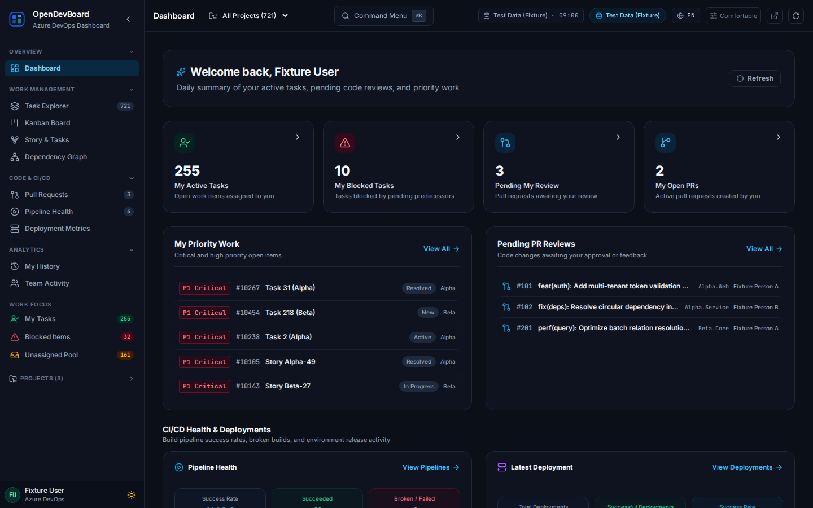
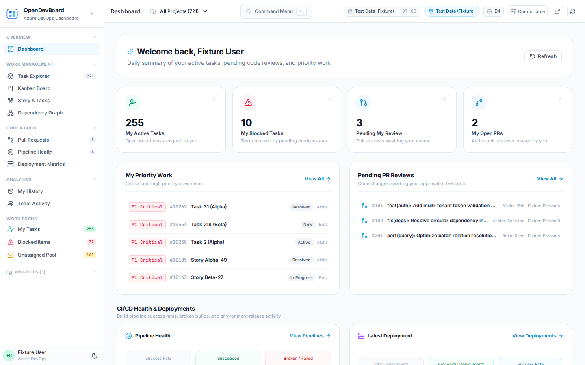
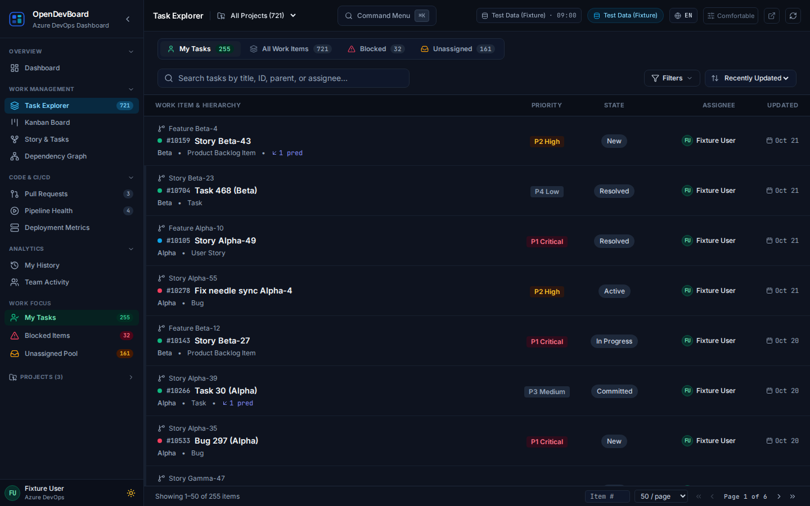
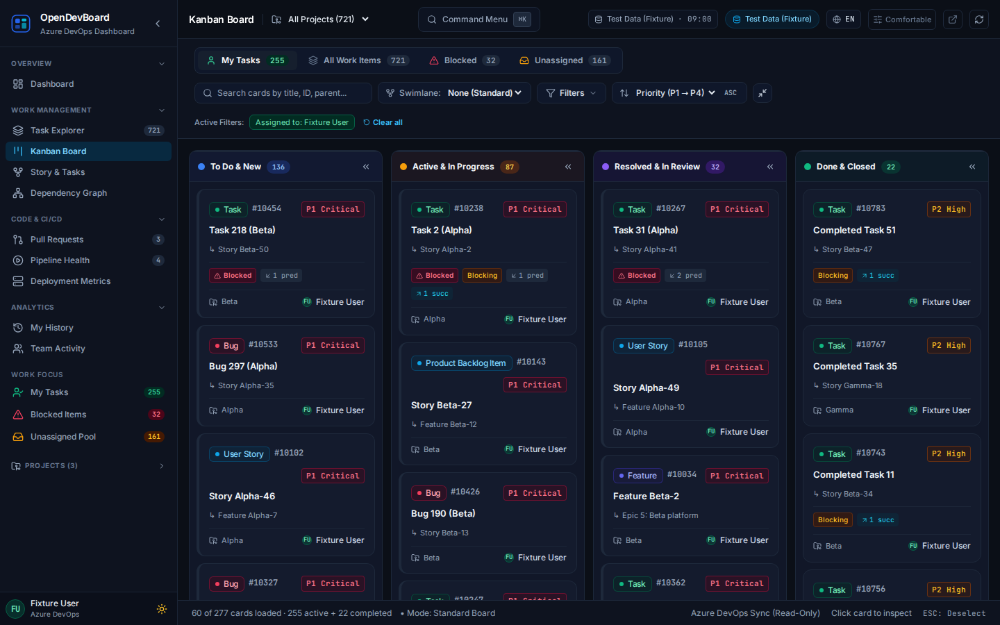
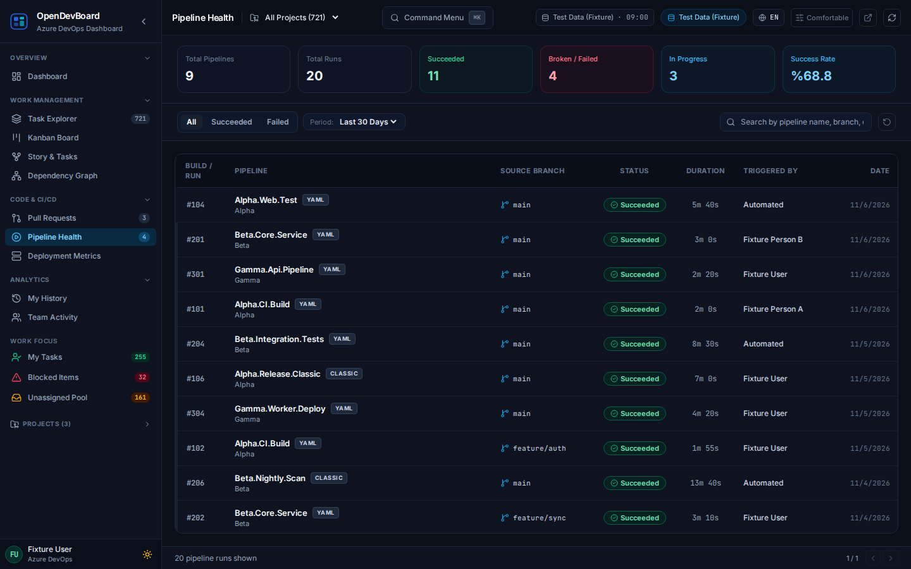

# OpenDevBoard

[English](README.md) | [Türkçe](README.tr.md)

Open-Source Dashboard for Azure DevOps. OpenDevBoard is a read-only dashboard for Azure DevOps teams. It presents work items, pull requests, pipelines, deployments, team activity, and history through a modern web interface backed by a local cache.



## Features

- Browse Azure DevOps work items and pull requests.
- Review pipeline and deployment information.
- Explore team activity and personal history.
- Use the interface in Turkish or English, with light and dark themes.
- Run against deterministic demo data or connect to an Azure DevOps organization.

## Screenshots

Screenshots use synthetic fixture data.

| Dashboard Light | Task Explorer |
| --- | --- |
|  |  |
| Kanban | Pipelines |
|  |  |

## Quick start with Docker Compose

Start the stack in offline fixture/demo mode. No `.env`, organization URL, or PAT is required:

```sh
docker compose up --build -d
```

Open <http://localhost:5174>. Check service health with `docker compose ps` and backend logs with `docker compose logs api`. Stop the stack with `docker compose down`; this preserves the project-scoped SQLite cache volume. For live Azure DevOps data, set `DEVOPS_FIXTURE_MODE=0`, `AZURE_DEVOPS_ORG_URL`, and a read-only `AZURE_DEVOPS_PAT` in the ignored root `.env`. Placeholder values are not included in the shipped template.

See [Docker setup](docs/docker-setup.md) for service and environment details.

## Architecture

The Public Edition consists of a React 19, TypeScript, Vite, and Tailwind frontend and a Python 3.12 Flask backend. The frontend is served by nginx and sends `/api` requests through its reverse proxy to the backend. The backend is the only component that contacts Azure DevOps and stores its cache in SQLite. Docker Compose runs the `web` and `api` services; the API port is not published to the host.

## Requirements

- Docker Engine with Docker Compose v2 (recommended for the complete stack)
- For local frontend development: Node.js 22 and npm
- For local backend development: Python 3.12
- For live Azure DevOps data: an organization URL and a minimally privileged, read-only Personal Access Token (PAT)

## Azure DevOps read-only PAT

Create a PAT with only the read scopes required for the Azure DevOps data you intend to view. Configure it only as `AZURE_DEVOPS_PAT` for the backend through the root `.env` file. Do not put it in frontend variables, source files, shell history, logs, screenshots, bug reports, or commits. Do not commit `.env`; it is ignored by Git. Azure DevOps access is read-only: the application must not create, modify, approve, trigger, or delete Azure DevOps records.

## Environment variables

| Variable | Purpose |
| --- | --- |
| `AZURE_DEVOPS_ORG_URL` | Azure DevOps organization URL, e.g. `https://dev.azure.com/<organization>` |
| `AZURE_DEVOPS_PAT` | Backend-only, minimally scoped read-only PAT |
| `DEVOPS_FIXTURE_MODE` | Defaults to `1` for deterministic offline demo data; set `0` only for live Azure DevOps |
| `DEVOPS_DATA_DIR` | Backend SQLite data directory; Compose uses `/data` |
| `SYNC_INTERVAL_SEC` | Background synchronization interval in seconds |
| `DISABLE_BACKGROUND_SYNC` | Set to `1` to disable automatic background synchronization |
| `WEB_PORT` | Host port for the web service; defaults to `5174` |
| `VITE_API_BASE_URL` | Frontend API base path for local development; defaults to `/api` |

See [`.env.example`](.env.example) for the shipped template. Do not put secrets in `apps/web/.env` or `VITE_*` variables.

## Development setup

```sh
nvm use
cd apps/web
npm ci
npm test
npm run build
```

For backend development, create a Python 3.12 virtual environment in the repository root and install the pinned dependencies:

```sh
python3 -m venv .venv
.venv/bin/python -m pip install -c services/api/constraints.txt -r services/api/requirements.txt python-dateutil python-dotenv
.venv/bin/python -m unittest discover -s services/api -p 'test_*.py'
```

The default fixture E2E tests use synthetic data and do not need a PAT or Azure DevOps access. See [Development](docs/development.md).

## Testing

```sh
npm --prefix scripts run e2e:test
npm --prefix scripts run e2e
```

The E2E orchestrator runs suites sequentially. `e2e:test` checks the runner contract without a browser; `e2e` creates its own isolated offline fixture Compose stack and runs restart/outage/recovery checks. Install scripts dependencies with `npm ci --prefix scripts` and Chromium with `npm --prefix scripts exec -- playwright install chromium`. Frontend and backend tests are listed above. Validate Compose configuration with `docker compose config --quiet`.

## Project structure

```text
apps/web/       React, TypeScript and Vite user interface
services/api/   Flask API, Azure DevOps client, SQLite cache and backend tests
docs/           Setup, architecture, API behavior and feature guides
scripts/        Offline fixture E2E runner and its contract tests
docker-compose.yml
```

## Security considerations

The API is intended to remain internal to the Compose network; do not expose it directly to untrusted networks. Use a least-privilege, read-only PAT and keep it out of client-side configuration. The Compose file is a local development example, not a production deployment or security approval. Production use requires a separate review of identity, secret handling, TLS/ingress, network exposure, monitoring, backup/retention, and PAT policy.

Report suspected vulnerabilities privately to the repository maintainer rather than including credentials or exploit details in public issues.

## License

The Public Edition root is distributed under the MIT License. See [LICENSE](LICENSE). That license applies only to original OpenDevBoard contributions the maintainer is authorized to license; third-party components and assets remain subject to their own terms. See [Third-party notices](docs/THIRD_PARTY_NOTICES.md).

## Releases

See the [release and versioning policy](docs/release-plan.md) for release criteria and publication scope.

## Contributing

Contributions are welcome. Before opening a change, run the relevant frontend, backend, and fixture E2E checks; preserve the read-only Azure DevOps contract, keep secrets out of the repository, and update user-facing documentation when behavior or configuration changes. Keep changes focused and include tests for behavior changes.
